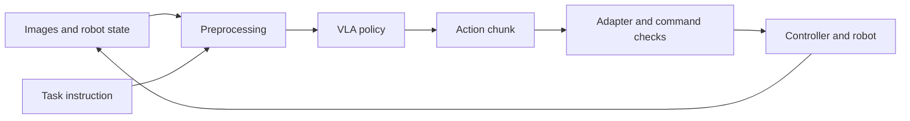

# Foundations: from observation to action

[Home](../README.en.md) · [中文](zh/00-start-here.md)

## What a VLA does

At time `t`, a policy receives an observation `o_t` and a task instruction. The observation may contain camera images and robot state. The output is an action or a sequence of actions called an **action chunk**. The exact inputs and outputs depend on the model and robot adapter.



The controller turns the policy's action representation into motor commands. An agent harness can also manage task state, tools, recording and recovery around this loop. A predicted action is not automatically a valid command for another robot.

## Terms you will use

| Term | Meaning | Concrete example |
| --- | --- | --- |
| Observation | Inputs available at a decision time | Two images and joint positions |
| State / proprioception | Robot measurements | Joint angles and gripper opening |
| Action | Output interpreted by an adapter | Joint position target or end-effector delta |
| Episode / demonstration | One recorded attempt | Reset, grasp, place, finish |
| Action chunk | Several future actions | Tensor with shape `(H, A)` |
| Prediction horizon `H` | Number of predicted steps | `H = 10` |
| Execution depth `s` | Number of steps used before replacing the plan | `s = 5`, with `s <= H` |
| Fine-tuning | Updating pretrained weights using task data | Training on recorded grasp-and-place episodes |
| Rollout | Running the policy in a closed loop | Observe, predict, execute, observe again |
| Checkpoint | Saved parameters and associated artifacts | Weights, configuration and normalization statistics |

## Read one sample

For a **teaching example**, suppose a single arm has six joints and a one-dimensional gripper command. An image might have shape `(480, 640, 3)`, state `(7,)`, and a predicted chunk `(10, 7)`. These shapes are illustrative, not a model API contract.

1. Find the camera and state feature names.
2. Check image channel order, dtype and value range.
3. Write down what each action dimension means, its unit and coordinate frame.
4. Confirm whether actions are absolute targets, deltas or velocities.
5. Find where normalization and its inverse happen.
6. Follow one chunk to the controller and count commands actually sent.

At 50 Hz, one step lasts 20 ms. Ten predicted steps cover 200 ms, but executing only five uses 100 ms before the next plan replaces them. Predicting ten steps does not require executing all ten.

## First exercise without a robot

Open one existing dataset and inspect an episode's images, state and actions. Record feature names, shapes, units, frame rate, task text and episode boundaries. If weights and compatible hardware are available, run inference on recorded observations without enabling actuators.

The repository includes optional diagnostics:

```bash
python scripts/diag_dataset.py /path/to/lerobot_dataset
python scripts/diag_policy.py --dataset /path/to/lerobot_dataset --config YOUR_CONFIG --checkpoint /path/to/checkpoint --show-obs
```

Dataset diagnostics need NumPy and PyArrow; policy diagnostics require a compatible openpi environment for inference. Adapt `build_obs` to the configured observation interface. These scripts diagnose data and predictions; they do not establish task success or deployment readiness.

**Completion check:** explain one input-to-action path, including units and normalization, without referring to the model's name alone.

Continue with [data and training](01-data-and-training.md). Reference implementations: [LeRobot](resources.md#lerobot) and [openpi](resources.md#openpi).
