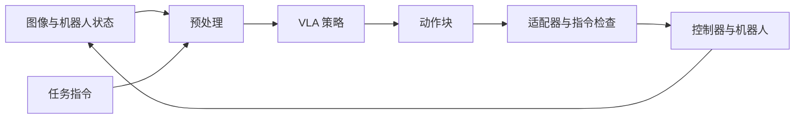

# 基础概念：从观测到动作

[首页](../../README.md) · [English](../00-start-here.md)

## VLA 做什么

在时刻 `t`，策略接收观测 `o_t` 和任务指令。观测可以包含相机图像与机器人状态。输出可以是一个动作，也可以是一段称为**动作块（action chunk）**的动作序列。具体输入输出取决于模型和机器人适配器。



控制器把策略的动作表示转换为电机指令。Agent harness 还可以在循环外管理任务状态、工具、记录与恢复。模型预测的动作不能自动成为另一种机器人的有效指令。

## 常用术语

| 术语 | 含义 | 具体例子 |
| --- | --- | --- |
| 观测 Observation | 决策时可用的输入 | 两张图像和关节位置 |
| 状态 / 本体感觉 State / Proprioception | 机器人测量值 | 关节角与夹爪开度 |
| 动作 Action | 由适配器解释的输出 | 关节位置目标或末端位姿增量 |
| Episode / 示教轨迹 | 一次完整尝试的记录 | 复位、抓取、放置、结束 |
| 动作块 Action chunk | 多个未来动作 | 形状为 `(H, A)` 的张量 |
| 预测步数 `H` | 一次预测多少步 | `H = 10` |
| 执行步数 `s` | 替换计划前使用多少步 | `s = 5`，且 `s <= H` |
| 微调 Fine-tuning | 用任务数据更新预训练权重 | 使用抓取放置示教训练 |
| Rollout | 在闭环中运行策略 | 观测、预测、执行、再次观测 |
| 检查点 Checkpoint | 保存的参数及关联资料 | 权重、配置与归一化统计量 |

## 读懂一个样本

以下是**教学示例**：单臂有六个关节和一维夹爪指令。图像形状可以是 `(480, 640, 3)`，状态为 `(7,)`，预测动作块为 `(10, 7)`。这些形状只用于说明，不代表某个模型的接口约定。

1. 找到相机和状态的特征名称。
2. 检查图像通道顺序、数据类型与数值范围。
3. 写出每个动作维度的含义、单位和坐标系。
4. 确认动作是绝对目标、增量还是速度。
5. 找到归一化与逆变换的位置。
6. 跟踪一个动作块到控制器，统计实际发出了多少条指令。

在 50 Hz 下，一步为 20 ms。预测十步覆盖 200 ms；若只执行五步，就在使用 100 ms 的动作后以新计划替换。预测十步不意味着必须全部执行。

## 第一个无机器人练习

打开已有数据集，检查一个 episode 的图像、状态与动作。记录特征名、形状、单位、帧率、任务文本和轨迹边界。如果已有权重与兼容计算硬件，可对已记录观测做离线推理，并保持执行器禁用。

仓库提供可选诊断脚本：

```bash
python scripts/diag_dataset.py /path/to/lerobot_dataset
python scripts/diag_policy.py --dataset /path/to/lerobot_dataset --config YOUR_CONFIG --checkpoint /path/to/checkpoint --show-obs
```

数据诊断需要 NumPy 和 PyArrow；策略诊断在推理时需要兼容的 openpi 环境。应根据配置的观测接口适配 `build_obs`。这些脚本诊断数据与预测，不证明任务成功或部署就绪。

**完成标准：**能解释一条输入到动作的路径，包括单位与归一化，而不只报出模型名称。

下一步阅读[数据与训练](01-data-and-training.md)。参考实现：[LeRobot](resources.md#lerobot)、[openpi](resources.md#openpi)。
